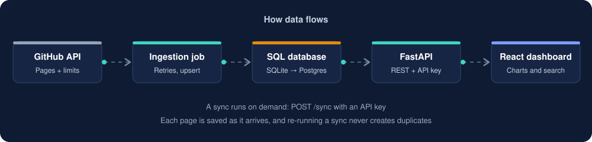

<p align="center">
  
</p>
A full-stack data product that pulls issues from any public GitHub repository, cleans the messy data, stores it in SQL, and serves it through a REST API to a React dashboard.
It is built the way customer-facing integration work goes: unreliable external API, messy data, a working product at the end.
> **Live demo:** coming soon
How it works
<p align="center">
  
</p>
Ingestion calls GitHub's issues API page by page, skips pull requests, repairs bad fields, and upserts into the database.
API exposes summary numbers, weekly trends, label counts, a searchable issue list, and recent activity.
Dashboard shows it all as cards, charts, and a table, with a protected "Sync now" button.
<!-- After you take a screenshot, save it as assets/dashboard.png and remove this comment:
<p align="center"></p>
Features
Open, closed, and average time-to-close figures with a resolved-percentage ring
Weekly opened vs closed area chart and a label donut chart
Searchable, filterable, paginated issue table
Recent activity feed and sync history
Collapsible sidebar and a responsive layout
API-key protected sync endpoint
Tech stack
Layer	Tools
Backend	Python, FastAPI, Pydantic, SQLAlchemy 2.0, httpx, tenacity
Database	SQLite for development, PostgreSQL for deployment
Frontend	React, Vite, TanStack Query, Recharts
Run locally
Backend
```bash
cd issue-analytics-backend
python -m venv .venv
.venv\Scripts\Activate.ps1        # macOS/Linux: source .venv/bin/activate
pip install -r requirements.txt
cp .env.example .env              # Windows: copy .env.example .env
uvicorn app.main:app --reload
```
Open http://127.0.0.1:8000/docs, then run `POST /sync` with the `X-API-Key` value from your `.env` to load data. Set `GITHUB_REPO` in `.env` to choose a repository, for example `pallets/flask`.
Frontend
```bash
cd issue-analytics-frontend
npm install
echo VITE_API_URL=http://localhost:8000 > .env
npm run dev
```
Without `VITE_API_URL`, the dashboard runs on built-in demo data.
API at a glance
Method	Path	Purpose
GET	`/summary`	Open, closed, total, average days to close
GET	`/timeseries`	Opened and closed counts for the last 18 weeks
GET	`/labels`	Issue counts per label
GET	`/issues`	Filter by `state`, `label`, search with `q`, paginate with `page`
GET	`/activity`	Recent issue and sync events
GET	`/sync/status`	Result of the latest sync
POST	`/sync`	Run a sync (requires `X-API-Key`)
Design decisions
Idempotent sync. Issues are upserted on GitHub's own id, so running a sync twice never creates duplicates.
Retries with backoff. Network errors and 5xx responses retry with exponential backoff. Rate limits do not retry; the run stops and reports when the limit resets.
Partial progress is kept. Each page is committed as it arrives, so a failure part-way keeps earlier pages and the run is recorded as partial.
Messy data is handled at the edge. Pull requests mixed into the issues endpoint, deleted authors, empty bodies, and malformed rows are handled in one place, and bad rows are counted as errors instead of crashing the sync.
Secrets stay out of the browser. The API key is typed into the Sync page and kept in memory only. CORS is limited to the frontend origin.
One file talks to the backend. The frontend reaches the API only through `src/api.js`, which let the UI be built and tested on demo data first.
Roadmap
[ ] Automated tests with GitHub mocked
[ ] Deploy backend and frontend
[ ] Run syncs as background jobs
[ ] Database migrations with Alembic
[ ] Support several repositories from the dashboard